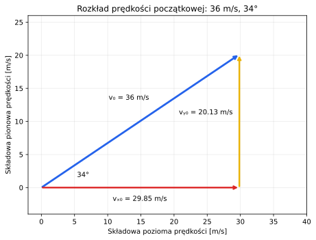
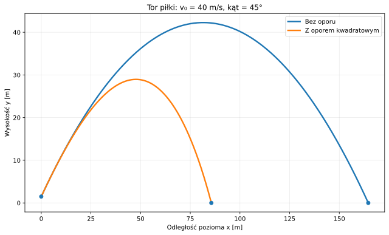
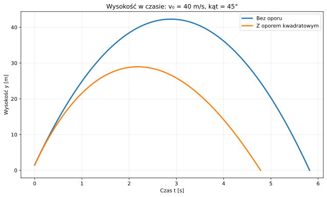
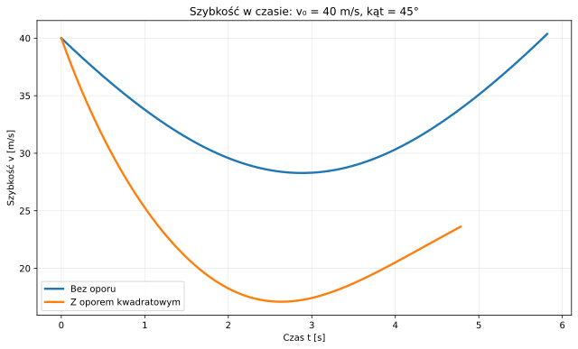
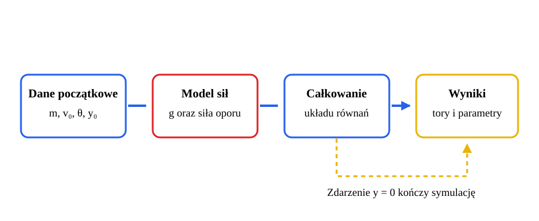

# Rzut ukośny — od modelu idealnego do oporu powietrza

*Raport obliczeniowy i przykład symulacji numerycznej w Pythonie.*

**Temat:** ruch ciała rzuconego pod kątem do poziomu.  
**Metoda:** wyprowadzenie równań, obliczenia analityczne bez oporu, symulacja z oporem kwadratowym.  
**Charakter danych:** przykład modelowy; wyniki nie pochodzą z pomiaru laboratoryjnego.

Rzut ukośny jest modelem ruchu ciała w polu grawitacyjnym. Bez oporu powietrza pozioma składowa prędkości pozostaje stała, a pionowa zmienia się pod wpływem siły ciężkości. Opór powietrza wpływa na obie składowe prędkości, skraca czas lotu i zasięg oraz sprawia, że tor nie jest parabolą.

## Spis treści

1. [Cel i założenia](#1-cel-i-założenia)
2. [Rzut bez oporu powietrza](#2-rzut-bez-oporu-powietrza)
3. [Rzut z oporem powietrza](#3-rzut-z-oporem-powietrza)
4. [Przykład liczbowy i porównanie](#4-przykład-liczbowy-i-porównanie)
5. [Kod i odtwarzanie wyników](#5-kod-i-odtwarzanie-wyników)
6. [Ograniczenia modelu](#6-ograniczenia-modelu)
7. [Wnioski](#7-wnioski)
8. [Dalsza lektura](#8-dalsza-lektura)

---

## 1. Cel i założenia

Celem raportu jest porównanie toru, czasu lotu, maksymalnej wysokości i zasięgu w dwóch modelach ruchu: idealnym, w którym po wyrzuceniu działa wyłącznie siła ciężkości, oraz uwzględniającym kwadratowy opór powietrza. W każdym porównaniu obu modeli przyjmujemy te same warunki początkowe i parametry ciała. Dzięki temu różnice wynikają z uwzględnienia oporu, a nie ze zmiany danych wejściowych. Model bez oporu rozwiązujemy analitycznie, a równania z oporem — numerycznie. Przedstawione wartości są wynikami modelu, nie pomiarami rzeczywistego lotu.

### 1.1. Układ współrzędnych i warunki początkowe

Ruch opisujemy w pionowej płaszczyźnie. Początek układu współrzędnych znajduje się na wysokości powierzchni lądowania, bezpośrednio pod miejscem wyrzutu. Oś $x$ jest pozioma i skierowana zgodnie z poziomą składową prędkości początkowej, a oś $y$ jest pionowa i skierowana ku górze. W chwili $t=0$ ciało znajduje się w punkcie $(0,y_0)$ i ma szybkość $v_0$; kąt $\theta$ mierzymy od dodatniego kierunku osi $x$.

Początkowe składowe prędkości są równe:

$$
\begin{aligned}
v_{x0} &= v_0\cos\theta, &
v_{y0} &= v_0\sin\theta.
\end{aligned}
$$


_Rysunek 1. Rozkład prędkości początkowej na składową poziomą i pionową._

W modelu z oporem przyjmujemy, że powietrze jest nieruchome względem układu odniesienia, a jego gęstość $\rho$ oraz współczynnik oporu $C_d$ są stałe. Masa ciała i pole powierzchni czołowej $A$ również się nie zmieniają. Pomijamy wiatr, obrót ciała i wynikającą z niego siłę nośną, w tym siłę Magnusa. Przyspieszenie grawitacyjne $g$ jest stałe, a powierzchnię lądowania modelujemy jako płaszczyznę poziomą $y=0$. Lądowanie oznacza pierwsze ponowne osiągnięcie tej płaszczyzny po starcie, czyli pierwszą chwilę $t>0$, w której $y(t)=0$ podczas opadania.

### 1.2. Symbole i jednostki

| Symbol | Znaczenie | Jednostka SI |
| :--- | :--- | :---: |
| $t$ | czas liczony od chwili wyrzutu | $\mathrm{s}$ |
| $x$, $y$, $y_0$ | współrzędne położenia i wysokość początkowa | $\mathrm{m}$ |
| $v_x$, $v_y$ | składowe prędkości | $\mathrm{m/s}$ |
| $v$, $v_0$ | szybkość chwilowa i początkowa, $v=\sqrt{v_x^2+v_y^2}$ | $\mathrm{m/s}$ |
| $a_x$, $a_y$ | składowe przyspieszenia | $\mathrm{m/s^2}$ |
| $m$ | masa ciała | $\mathrm{kg}$ |
| $g$ | przyspieszenie ziemskie | $\mathrm{m/s^2}$ |
| $\theta$ | kąt wyrzutu względem poziomu | $^\circ$ lub $\mathrm{rad}$ |
| $\rho$ | gęstość powietrza | $\mathrm{kg/m^3}$ |
| $C_d$ | bezwymiarowy współczynnik oporu | $1$ |
| $A$, $r$ | pole powierzchni czołowej i promień piłki w przykładzie | $\mathrm{m^2}$, $\mathrm{m}$ |
| $k=\tfrac{1}{2}\rho C_d A$ | stała w modelu oporu kwadratowego | $\mathrm{kg/m}$ |
| $R$ | zasięg poziomy | $\mathrm{m}$ |

## 2. Rzut bez oporu powietrza

### 2.1. Równania ruchu

W modelu idealnym jedyną siłą działającą na ciało po wyrzuceniu jest siła ciężkości $\vec{F}_g=(0,-mg)$. Z drugiej zasady dynamiki Newtona:

$$
\begin{aligned}
m\ddot{x} &= 0, &
m\ddot{y} &= -mg.
\end{aligned}
$$

Po skróceniu przez masę otrzymujemy stałe przyspieszenia $a_x=0$ i $a_y=-g$. Dla warunków początkowych $x(0)=0$ oraz $y(0)=y_0$ rozwiązania są następujące:

$$
\begin{aligned}
x(t) &= v_0 t\cos\theta,\\
y(t) &= y_0+v_0 t\sin\theta-\frac{1}{2}gt^2.
\end{aligned}
$$

Prędkość w każdej chwili wynosi:

$$
\begin{aligned}
v_x(t) &= v_0\cos\theta,\\
v_y(t) &= v_0\sin\theta-gt.
\end{aligned}
$$

### 2.2. Tor, wierzchołek i czas lotu


_Rysunek 2. W najwyższym punkcie toru składowa pionowa prędkości jest równa zeru._

Po wyeliminowaniu czasu $t=\tfrac{x}{v_0\cos\theta}$ otrzymujemy równanie toru:

$$
\begin{aligned}
y(x) &= y_0+x\tan\theta\\
&\quad-\frac{g x^2}{2v_0^2\cos^2\theta}.
\end{aligned}
$$

Jest to parabola. W najwyższym punkcie $v_y=0$, zatem:

$$
\begin{aligned}
t_{\mathrm{w}} &= \frac{v_0\sin\theta}{g},\\
x_{\mathrm{w}} &= \frac{v_0^2\sin(2\theta)}{2g},\\
y_{\max} &= y_0+\frac{v_0^2\sin^2\theta}{2g}.
\end{aligned}
$$

Chwilę lądowania wyznacza dodatni pierwiastek równania $y(t)=0$:

$$
t_{\mathrm{lot}} = \frac{v_0\sin\theta+\sqrt{(v_0\sin\theta)^2+2gy_0}}{g}
$$

Zasięg poziomy wynosi $R=x(t_{\mathrm{lot}})$. Gdy miejsce wyrzutu i płaszczyzna lądowania znajdują się na tej samej wysokości, czyli $y_0=0$, wzór na zasięg upraszcza się do:

$$
R = \frac{v_0^2\sin(2\theta)}{g}.
$$

Przy ustalonej szybkości początkowej największy zasięg w tym przypadku występuje dla kąta $\theta=45^\circ$. Gdy $y_0>0$, kąt maksymalnego zasięgu nie musi wynosić $45^\circ$.

### 2.3. Energia w modelu idealnym

Pomijając opór, energia mechaniczna jest zachowana:

$$
E = \frac{1}{2}mv^2+mgy = \mathrm{const}
$$

W czasie wznoszenia energia kinetyczna maleje, a potencjalna rośnie. Podczas opadania zachodzi odwrotna przemiana. Nie oznacza to, że szybkość maleje przez cały lot: po osiągnięciu wierzchołka zaczyna rosnąć.

## 3. Rzut z oporem powietrza

### 3.1. Model oporu kwadratowego

Dla ciała poruszającego się w powietrzu przyjmujemy często opór proporcjonalny do kwadratu szybkości. Wektor siły jest przeciwnie skierowany do prędkości:

$$
\vec{F}_{\mathrm{op}} = -\frac{1}{2}\rho C_d A\,v\vec{v}
$$

Współczynnik $C_d$ zależy między innymi od kształtu ciała i liczby Reynoldsa. Wprowadzając oznaczenie $k=\tfrac{1}{2}\rho C_d A$, zapisujemy równania składowych ruchu:

$$
\begin{aligned}
\dot{x} &= v_x,\\
\dot{y} &= v_y,\\
\dot{v}_x &= -\frac{k}{m}v v_x,\\
\dot{v}_y &= -g-\frac{k}{m}v v_y,\\
v &= \sqrt{v_x^2+v_y^2}.
\end{aligned}
$$

Siła oporu ma składową poziomą i pionową. Wskutek tego $v_x$ nie jest stałe, a tor nie jest parabolą. Zależność siły od szybkości $v=\sqrt{v_x^2+v_y^2}$ sprawia, że w ogólności nie można rozwiązać tych równań za pomocą prostych wzorów analitycznych. W przykładzie układ czterech równań różniczkowych pierwszego rzędu rozwiązujemy numerycznie.

### 3.2. Kontrola kierunku siły i energii


_Rysunek 3. Siła ciężkości jest zawsze skierowana w dół, a siła oporu — przeciwnie do wektora prędkości._

Iloczyn skalarny siły oporu i prędkości jest niedodatni:

$$
\vec{F}_{\mathrm{op}}\cdot\vec{v} = -kv^3 \leq 0
$$

Siła oporu zawsze zmniejsza energię mechaniczną. Nie działa jednak wyłącznie w dół: podczas wznoszenia jej składowa pionowa jest skierowana w dół, a podczas opadania — ku górze. W obu fazach siła oporu jest skierowana przeciwnie do chwilowej prędkości.

### 3.3. Prędkość graniczna

Przy pionowym spadaniu z oporem kwadratowym prędkość graniczną wyznaczamy, równoważąc siłę ciężkości z wartością siły oporu:

$$
\begin{aligned}
mg &= kv_{\mathrm{gr}}^2,\\
v_{\mathrm{gr}} &= \sqrt{\frac{mg}{k}},\\
v_{\mathrm{gr}} &= \sqrt{\frac{2mg}{\rho C_d A}}.
\end{aligned}
$$

Jest to graniczna szybkość dla idealizowanego spadania pionowego przy stałych $\rho$ i $C_d$. W rzucie ukośnym trajektoria nie osiąga w ogólności tego prostego stanu równowagi.

## 4. Przykład liczbowy i porównanie

Rozpatrujemy modelową piłkę baseballową wyrzuconą z wysokości $1{,}50\,\mathrm{m}$. Gęstość powietrza przyjmujemy jako $\rho=1{,}225\,\mathrm{kg/m^3}$. Parametry piłki wynoszą: masa $m=0{,}145\,\mathrm{kg}$, promień $r=0{,}0366\,\mathrm{m}$ i współczynnik oporu $C_d=0{,}47$. Pole powierzchni czołowej obliczamy ze wzoru $A=\pi r^2$. Podpunkt 4.1 przedstawia osobny rzut z szybkością $36\,\mathrm{m/s}$ i kątem $34^\circ$, natomiast w podpunktach 4.2–4.3 porównujemy kąty wyrzutu przy szybkości $40\,\mathrm{m/s}$; w każdym przypadku pozostałe parametry są takie same.

### 4.1. Główny przykład

W tym przykładzie przyjmujemy szybkość początkową $36\,\mathrm{m/s}$ i kąt wyrzutu $34^\circ$, zachowując parametry piłki, powietrza i wysokość początkową podane powyżej. Początkowy wektor prędkości rozkładamy na składowe:

$$
\begin{aligned}
v_{x0} &= 36\cos(34^\circ) \approx 29{,}85\,\mathrm{m/s},\\
v_{y0} &= 36\sin(34^\circ) \approx 20{,}13\,\mathrm{m/s}.
\end{aligned}
$$



_Rysunek 4. Wektor prędkości początkowej ma wartość $36\,\mathrm{m/s}$ i jest nachylony do poziomu pod kątem $34^\circ$._

| Model | Czas lotu [s] | Maks. wysokość [m] | Zasięg [m] |
| :--- | ---: | ---: | ---: |
| Bez oporu powietrza | 4,177 | 22,155 | 124,675 |
| Z oporem kwadratowym | 3,626 | 16,943 | 75,314 |

Bez oporu pozioma składowa prędkości pozostaje stała, a pionowa zmienia się pod wpływem przyspieszenia grawitacyjnego $g$. Po uwzględnieniu oporu obie składowe prędkości zmieniają się w czasie, a tor ma mniejszy zasięg i wysokość maksymalną. Jest to osobny przykład; nie należy do porównania kątów przedstawionego w punkcie 4.2.

### 4.2. Przykład dodatkowy: zmiana kąta wyrzutu

| Kąt $\theta$ | Model | Czas lotu [s] | Maks. wysokość [m] | Zasięg [m] |
| :---: | :--- | ---: | ---: | ---: |
| $30^\circ$ | bez oporu | 4,151 | 21,887 | 143,800 |
| $30^\circ$ | opór kwadratowy | 3,556 | 16,349 | 83,084 |
| $45^\circ$ | bez oporu | 5,819 | 42,275 | 164,585 |
| $45^\circ$ | opór kwadratowy | 4,782 | 28,960 | 85,603 |
| $60^\circ$ | bez oporu | 7,105 | 62,662 | 142,109 |
| $60^\circ$ | opór kwadratowy | 5,722 | 40,947 | 71,176 |

Wartości dla modelu bez oporu obliczono analitycznie. Równania z oporem rozwiązano funkcją `solve_ivp` z domyślną metodą RK45 (metoda Dormanda–Prince'a rzędu 5(4)), przy maksymalnym kroku całkowania $0{,}0005\,\mathrm{s}$, tolerancji względnej $10^{-9}$ i bezwzględnej $10^{-11}$. Dla przyjętych parametrów kąt $45^\circ$ zapewnia największy zasięg spośród trzech badanych kątów w obu modelach. Nie jest to jednak reguła uniwersalna — optymalny kąt zależy między innymi od wysokości początkowej, szybkości początkowej i parametrów oporu.

Przy kącie $45^\circ$ uwzględnienie oporu zmniejsza zasięg o około $48\%$, maksymalną wysokość o około $31\%$, a czas lotu o około $18\%$. Różnice te wynikają z zależności siły oporu od wartości i kierunku prędkości. Nie można więc poprawnie uwzględnić oporu przez samo zmniejszenie przyspieszenia grawitacyjnego.

### 4.3. Przykład dodatkowy: trzy wykresy dla kąta $45^\circ$

Pierwszy wykres porównuje tory piłki, drugi przedstawia jej wysokość w funkcji czasu, a trzeci — szybkość. Wszystkie wykresy dotyczą tych samych warunków początkowych i modeli co wiersze tabeli dla kąta $45^\circ$.



_Rysunek 5. Tor obliczony dla $v_0=40\,\mathrm{m/s}$ i $\theta=45^\circ$; opór obniża wierzchołek i zmniejsza zasięg._



_Rysunek 6. Wysokość w czasie dla tych samych warunków początkowych: $v_0=40\,\mathrm{m/s}$ i $\theta=45^\circ$._



_Rysunek 7. Szybkość w czasie dla tych samych warunków początkowych. Bez oporu osiąga minimum w wierzchołku toru._

### 4.4. Jak odczytać wyniki symulacji?



_Rysunek 8. Symulacja z oporem kończy się, gdy algorytm całkujący wykryje, że piłka osiągnęła płaszczyznę lądowania $y=0$._

Przy kącie $30^\circ$ piłka osiąga niższą wysokość maksymalną i ma krótszy czas lotu niż przy kącie $45^\circ$, ale większa część jej prędkości początkowej jest skierowana poziomo. Przy kącie $60^\circ$ piłka wznosi się najwyżej i pozostaje w powietrzu najdłużej, lecz mniejsza pozioma składowa prędkości początkowej ogranicza zasięg. Opór powietrza dodatkowo zmniejsza zasięg, ponieważ działa przeciwnie do wektora prędkości i wpływa na obie jego składowe.

## 5. Kod i odtwarzanie wyników

Kod wykorzystuje biblioteki NumPy, SciPy i Matplotlib. Odtwarza wyniki z punktów 4.1–4.3 i generuje cztery ilustracje SVG osadzone w punkcie 4: rozkład prędkości dla $36\,\mathrm{m/s}$ i $34^\circ$ oraz trzy wykresy dla $40\,\mathrm{m/s}$ i $45^\circ$. Dane do krzywych pochodzą bezpośrednio z rozwiązań równań ruchu.

### 5.1. Uruchomienie w Google Colabie

1. Otwórz [Google Colab](https://colab.research.google.com/) i utwórz nowy notatnik.
2. W pierwszej komórce zainstaluj wymagane biblioteki:

```python
%pip install numpy scipy matplotlib
```

3. Skopiuj cały poniższy blok kodu do kolejnej komórki i uruchom ją. Kod oblicza wyniki, wyświetla wykresy i zapisuje pliki SVG w bieżącym katalogu. W Colabie pobierz je z panelu plików, jeśli chcesz zaktualizować ilustracje w repozytorium.

### 5.2. Uruchomienie lokalne

Zapisz poniższy blok kodu w pliku `generuj_wykresy.py` w katalogu `pages/solutions/04_sol_vscode`. Następnie w terminalu przejdź do tego katalogu i wykonaj:

```bash
python -m pip install numpy scipy matplotlib
python generuj_wykresy.py
```

Pliki SVG zostaną zapisane w bieżącym katalogu, czyli w `pages/solutions/04_sol_vscode`, jeśli uruchomisz polecenia z tego katalogu. Kod nadpisuje generowane ilustracje osadzone w raporcie; schemat obliczeń nie jest generowany przez ten skrypt.

```python
import math
import numpy as np
import matplotlib.pyplot as plt
from scipy.integrate import solve_ivp

def zapisz_wykres(nazwa):
	plt.savefig(f"{nazwa}.svg", format="svg", bbox_inches="tight")
	plt.show()
	plt.close()

g = 9.81
m = 0.145
radius = 0.0366
rho = 1.225
Cd = 0.47
v0 = 40.0
angle = math.radians(45.0)
y0 = 1.5
area = math.pi * radius**2
k = 0.5 * rho * Cd * area
vx0 = v0 * math.cos(angle)
vy0 = v0 * math.sin(angle)

# Rozwiązanie analityczne bez oporu.
t_vacuum = (vy0 + math.sqrt(vy0**2 + 2 * g * y0)) / g
t_ideal = np.linspace(0, t_vacuum, 500)
x_ideal = vx0 * t_ideal
y_ideal = y0 + vy0 * t_ideal - 0.5 * g * t_ideal**2
ymax_ideal = y0 + vy0**2 / (2 * g)

# Stan: x, y, vx, vy. Opór działa przeciwnie do wektora prędkości.
def equations(t, state):
	x, y, vx, vy = state
	speed = math.hypot(vx, vy)
	return (
		vx,
		vy,
		-(k / m) * speed * vx,
		-g - (k / m) * speed * vy,
	)

def landing(t, state):
	return state[1]

landing.terminal = True
landing.direction = -1

solution = solve_ivp(
	equations,
	(0, 20),
	(0, y0, vx0, vy0),
	events=landing,
	max_step=0.0005,
	rtol=1e-9,
	atol=1e-11,
)

t_drag = solution.t
x_drag, y_drag = solution.y[0], solution.y[1]
flight_drag = solution.t_events[0][0]
range_drag = solution.y_events[0][0][0]
height_drag = np.max(y_drag)
range_ideal = x_ideal[-1]

print(f"Bez oporu: czas = {t_vacuum:.3f} s, "
	  f"wysokość = {ymax_ideal:.3f} m, zasięg = {range_ideal:.3f} m")
print(f"Z oporem:  czas = {flight_drag:.3f} s, "
	  f"wysokość = {height_drag:.3f} m, zasięg = {range_drag:.3f} m")

plt.figure(figsize=(9, 5.5))
plt.plot(x_ideal, y_ideal, label="Bez oporu", linewidth=2.4)
plt.plot(x_drag, y_drag, label="Z oporem kwadratowym", linewidth=2.4)
plt.scatter([0, range_ideal, range_drag], [y0, 0, 0], s=35, zorder=3)
plt.xlabel("Odległość pozioma x [m]")
plt.ylabel("Wysokość y [m]")
plt.title("Tor piłki: v₀ = 40 m/s, kąt = 45°")
plt.grid(alpha=0.25)
plt.legend()
plt.tight_layout()
zapisz_wykres("wykres_toru")
 
# Wysokość w funkcji czasu.
plt.figure(figsize=(9, 5.5))
plt.plot(t_ideal, y_ideal, label="Bez oporu", linewidth=2.4)
plt.plot(t_drag, y_drag, label="Z oporem kwadratowym", linewidth=2.4)
plt.xlabel("Czas t [s]")
plt.ylabel("Wysokość y [m]")
plt.title("Wysokość w czasie: v₀ = 40 m/s, kąt = 45°")
plt.grid(alpha=0.25)
plt.legend()
plt.tight_layout()
zapisz_wykres("wykres_wysokosci")

# Szybkość w funkcji czasu.
speed_ideal = np.hypot(vx0, vy0 - g * t_ideal)
speed_drag = np.hypot(solution.y[2], solution.y[3])
plt.figure(figsize=(9, 5.5))
plt.plot(t_ideal, speed_ideal, label="Bez oporu", linewidth=2.4)
plt.plot(t_drag, speed_drag, label="Z oporem kwadratowym", linewidth=2.4)
plt.xlabel("Czas t [s]")
plt.ylabel("Szybkość v [m/s]")
plt.title("Szybkość w czasie: v₀ = 40 m/s, kąt = 45°")
plt.grid(alpha=0.25)
plt.legend()
plt.tight_layout()
zapisz_wykres("wykres_szybkosci")

# Tabela porównawcza dla trzech kątów wyrzutu.
for angle_degrees in (30, 45, 60):
	angle_value = math.radians(angle_degrees)
	initial_vx = v0 * math.cos(angle_value)
	initial_vy = v0 * math.sin(angle_value)
	flight_ideal = (initial_vy + math.sqrt(initial_vy**2 + 2 * g * y0)) / g
	height_ideal = y0 + initial_vy**2 / (2 * g)
	range_ideal_angle = initial_vx * flight_ideal
	result = solve_ivp(
		equations,
		(0, 20),
		(0, y0, initial_vx, initial_vy),
		events=landing,
		max_step=0.0005,
		rtol=1e-9,
		atol=1e-11,
	)
	flight_drag_angle = result.t_events[0][0]
	height_drag_angle = np.max(result.y[1])
	range_drag_angle = result.y_events[0][0][0]
	print(f"{angle_degrees}°: bez oporu "
		f"{flight_ideal:.3f} s, {height_ideal:.3f} m, {range_ideal_angle:.3f} m; "
		f"z oporem {flight_drag_angle:.3f} s, "
		f"{height_drag_angle:.3f} m, {range_drag_angle:.3f} m")

# Osobny przykład: v0 = 36 m/s, kąt = 34 stopnie.
extra_v0 = 36.0
extra_angle = math.radians(34.0)
extra_vx0 = extra_v0 * math.cos(extra_angle)
extra_vy0 = extra_v0 * math.sin(extra_angle)
extra_flight_ideal = (
	extra_vy0 + math.sqrt(extra_vy0**2 + 2 * g * y0)
) / g
extra_height_ideal = y0 + extra_vy0**2 / (2 * g)
extra_range_ideal = extra_vx0 * extra_flight_ideal
extra_solution = solve_ivp(
	equations,
	(0, 20),
	(0, y0, extra_vx0, extra_vy0),
	events=landing,
	max_step=0.0005,
	rtol=1e-9,
	atol=1e-11,
)
print(f"Przykład 36 m/s, 34°: vx0 = {extra_vx0:.2f} m/s, "
	f"vy0 = {extra_vy0:.2f} m/s")
print(f"Bez oporu: {extra_flight_ideal:.3f} s, "
	f"{extra_height_ideal:.3f} m, {extra_range_ideal:.3f} m")
print(f"Z oporem: {extra_solution.t_events[0][0]:.3f} s, "
	f"{np.max(extra_solution.y[1]):.3f} m, "
	f"{extra_solution.y_events[0][0][0]:.3f} m")

# Rysunek z punktu 4.1: wektor i jego składowe dla 36 m/s oraz 34°.
plt.figure(figsize=(8, 5))
plt.annotate(
	"",
	xy=(extra_vx0, extra_vy0),
	xytext=(0, 0),
	arrowprops={"arrowstyle": "->", "color": "#2563eb", "linewidth": 2.8},
)
plt.annotate(
	"",
	xy=(extra_vx0, 0),
	xytext=(0, 0),
	arrowprops={"arrowstyle": "->", "color": "#dc2626", "linewidth": 2.4},
)
plt.annotate(
	"",
	xy=(extra_vx0, extra_vy0),
	xytext=(extra_vx0, 0),
	arrowprops={"arrowstyle": "->", "color": "#eab308", "linewidth": 2.4},
)
plt.text(extra_vx0 * 0.34, extra_vy0 * 0.66, "v₀ = 36 m/s")
plt.text(extra_vx0 * 0.36, -2.0, f"vₓ₀ = {extra_vx0:.2f} m/s")
plt.text(
	extra_vx0 - 1.0,
	extra_vy0 * 0.55,
	f"vᵧ₀ = {extra_vy0:.2f} m/s",
	ha="right",
)
plt.text(extra_vx0 * 0.18, extra_vy0 * 0.08, "34°")
plt.xlabel("Składowa pozioma prędkości [m/s]")
plt.ylabel("Składowa pionowa prędkości [m/s]")
plt.title("Rozkład prędkości początkowej: 36 m/s, 34°")
plt.xlim(-2, 40)
plt.ylim(-4, 26)
plt.gca().set_aspect("equal", adjustable="box")
plt.grid(alpha=0.25)
plt.tight_layout()
zapisz_wykres("rozklad_predkosci_36_34")
```

Kod zapisuje trzy wykresy dla parametrów z tabeli w punkcie 4.2 (wiersz $45^\circ$) oraz rysunek rozkładu prędkości zgodny z parametrami i tabelą w punkcie 4.1. Poprawność obliczeń można sprawdzić, porównując wydrukowane wartości z tabelami z uwzględnieniem zaokrągleń. Po zmianie masy, rozmiaru piłki lub współczynnika $C_d$ należy ponownie rozwiązać równania. W modelu z oporem wyniki nie skalują się tak prosto jak w modelu bez oporu.

## 6. Ograniczenia modelu

- Przyjęto stałą gęstość powietrza oraz stały współczynnik $C_d$.
- Pominięto wiatr, rotację piłki oraz związane z nią efekty aerodynamiczne, w tym siłę Magnusa, która może odchylać tor.
- Przyjęto, że piłka jest kulą o stałym promieniu, a jej pole czołowe nie zmienia się w czasie.
- Model oporu kwadratowego jest przybliżeniem; rzeczywisty $C_d$ zależy od warunków przepływu.
- Ruch nad poziomą płaszczyzną lądowania opisano w dwuwymiarowym układzie współrzędnych.

Wyniki należy więc interpretować jako porównanie dwóch modeli fizycznych dla ustalonych parametrów, a nie precyzyjną prognozę konkretnego rzutu.

## 7. Wnioski

W modelu bez oporu składowa pozioma prędkości jest stała, a pionowa zmienia się pod wpływem grawitacji. Po wyeliminowaniu czasu zależność wysokości od odległości poziomej jest kwadratowa, dlatego tor ma kształt paraboli. Gdy miejsce lądowania znajduje się na tej samej wysokości co miejsce wyrzutu, największy zasięg w tym modelu występuje dla kąta $45^\circ$.

Przy uwzględnieniu oporu kwadratowego siła działa przeciwnie do wektora prędkości, więc zmienia jednocześnie jej składową poziomą i pionową. Tor przestaje być parabolą, a energia mechaniczna maleje. Dla przyjętych parametrów i kąta $45^\circ$ czas lotu skraca się z $5{,}819\,\mathrm{s}$ do $4{,}782\,\mathrm{s}$, maksymalna wysokość spada z $42{,}275\,\mathrm{m}$ do $28{,}960\,\mathrm{m}$, a zasięg z $164{,}585\,\mathrm{m}$ do $85{,}603\,\mathrm{m}$. Oznacza to zmniejszenie tych wielkości odpowiednio o około $18\%$, $31\%$ i $48\%$.

Porównanie kątów $30^\circ$, $45^\circ$ i $60^\circ$ wskazuje, że w badanym przykładzie największy zasięg uzyskano dla $45^\circ$ zarówno bez oporu, jak i z oporem. Nie jest to jednak dowód, że ten kąt zawsze zapewnia największy zasięg: wynik zależy między innymi od wysokości wyrzutu, szybkości początkowej i parametrów oporu. Wartości z symulacji należy zatem traktować jako wyniki przyjętego modelu, a nie uniwersalne dane dla każdej piłki i sytuacji.

Równania ruchu z oporem rozwiązano numerycznie, a dołączony kod pozwala odtworzyć obliczenia i wykresy. Wiarygodność rozwiązania numerycznego można dodatkowo ocenić, powtarzając obliczenia z mniejszym maksymalnym krokiem całkowania i mniejszymi tolerancjami algorytmu. Niezależnie od dokładności obliczeń zgodność wyników z rzeczywistym lotem ograniczają założenia modelu, takie jak stała gęstość powietrza i stały współczynnik oporu.

### Lista kontrolna raportu

- [x] Zdefiniowano układ współrzędnych, symbole, jednostki i założenia modelu.
- [x] Przedstawiono równania ruchu bez oporu oraz z oporem powietrza.
- [x] Porównano czas lotu, maksymalną wysokość i zasięg dla kilku kątów wyrzutu.
- [x] Dołączono wykresy i schematy ilustrujące ruch oraz działające siły.
- [x] Podano kod umożliwiający odtworzenie obliczeń i wykresów.
- [x] Zestawiono ograniczenia modelu i wskazano źródła do dalszej lektury.
- [ ] Raport przeczytany przez czytelnika.

## 8. Dalsza lektura

- [OpenStax: Projectile Motion](https://openstax.org/books/university-physics-volume-1/pages/4-3-projectile-motion) — ruch pocisku bez oporu powietrza.
- [NASA Glenn: The Drag Equation](https://www1.grc.nasa.gov/beginners-guide-to-aeronautics/drag-equation/) — równanie siły oporu i znaczenie jego parametrów.
